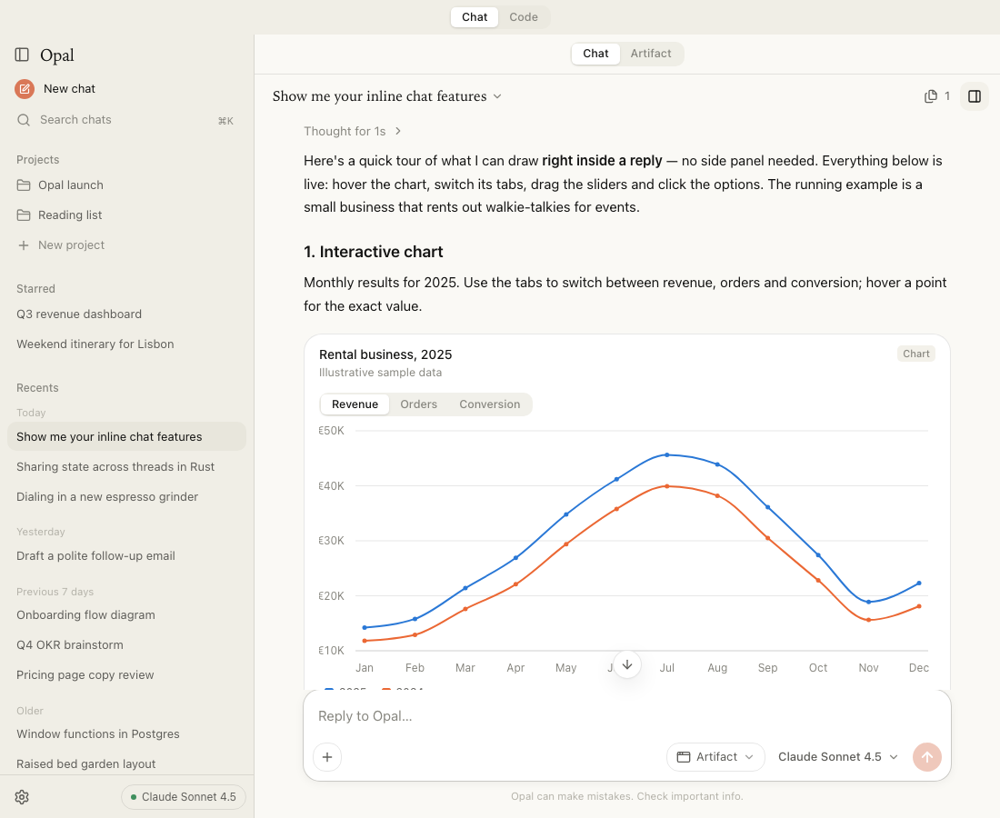
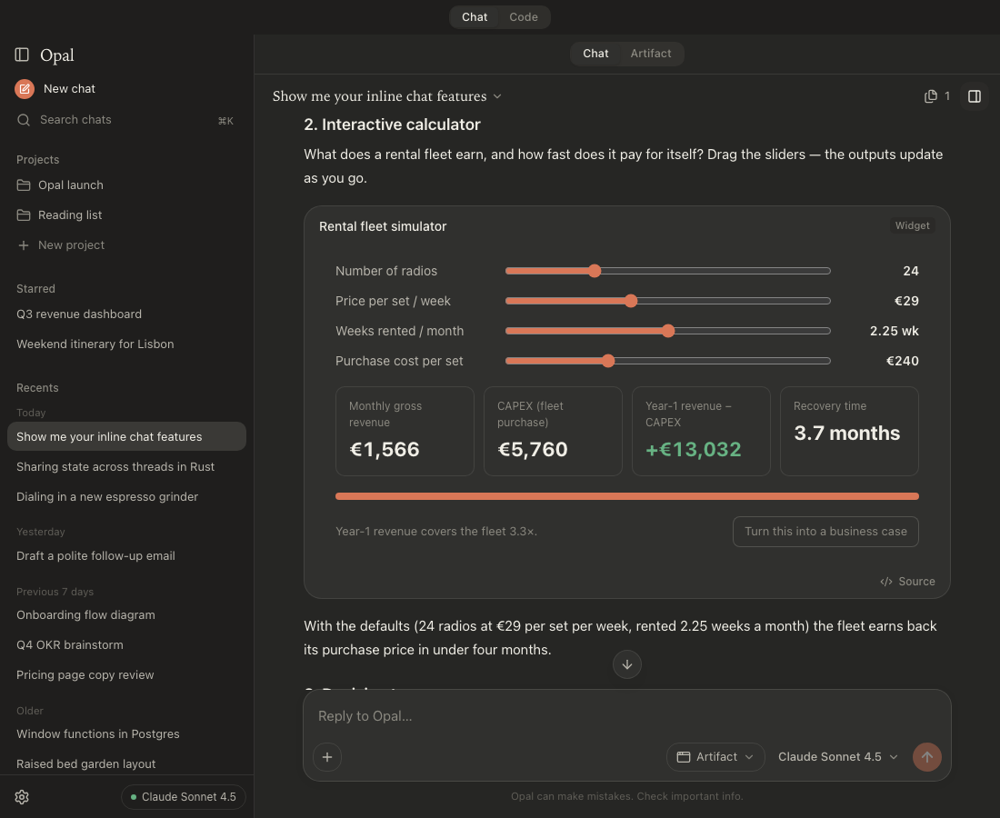

<p align="center">
  
</p>

<h1 align="center">Opal</h1>

<p align="center">
  A native macOS AI desktop client with chat, Projects and live Artifacts,<br/>
  powered by <a href="https://github.com/anomalyco/opencode">OpenCode</a> and any model provider.
</p>

---

| Light                                                           | Dark                                                          |
| --------------------------------------------------------------- | ------------------------------------------------------------- |
|  |  |

## Install

Download the latest `Opal-<version>-aarch64.dmg` from the
[Releases page](https://github.com/ditistijn/opal/releases/latest), open it and drag Opal to
Applications. The app is signed with a Developer ID and notarized. Apple silicon only for now.

Opal checks for updates on launch (and from **Opal › Check for Updates…**) and installs them in place;
see [docs/UPDATES.md](docs/UPDATES.md).

## What it is

Opal is warm, quiet and keyboard-first, and runs on **OpenCode** as its agent engine, so you can use **any provider and model** (Anthropic, OpenAI,
Google, OpenRouter, local models, custom OpenAI-compatible endpoints …).

It is a Tauri 2 app: a small Rust shell plus a React UI, with a private `opencode serve` process
bundled inside the app as a sidecar. Nothing is sent anywhere except to the model providers you
configure.

## Features

- **Chat** — streaming conversations with Markdown, code highlighting, reasoning and tool calls.
- **Projects** — group chats with shared instructions and knowledge files.
- **Artifacts** — the model builds HTML/React/SVG/Markdown/code artifacts that render live in a
  side panel (isolated `artifact://` origin), with full version history.
- **Conversations are sandboxes** — every chat gets its own folder; drop files in and the agent can
  actually read, process and produce files there.
- **Code** — an agentic coding surface: per-repo sessions, optional git worktrees, diffs, an
  integrated terminal, subagents, and inline permission prompts.
- **Any model** — providers and API keys managed in Settings; per-chat model and mode switching.
- **Inline widgets** — replies can carry interactive charts, sliders and calculators, decision
  trees, Mermaid diagrams and SVG, rendered right inside the message.
- **Sandboxed** — the agent's shell commands run under a macOS `sandbox-exec` profile that keeps
  them inside the conversation folder and away from the engine's credentials.
- **Native macOS** — transparent title bar with inset traffic lights, full menu bar with standard
  shortcuts, light/dark appearance, Dock reopen, signed and notarized DMG, over-the-air updates.

## Architecture

```
Opal.app
├── Rust core (Tauri 2)    spawns + supervises the sidecar, artifact:// protocol, settings, menu
├── WebView (React 19)     @opencode/client → http://127.0.0.1:<port> (Basic auth), SSE events
└── MacOS/opencode         OpenCode v2.2.5 `serve`, isolated XDG dirs under Application Support/Opal
```

Read [docs/ARCHITECTURE.md](docs/ARCHITECTURE.md) for the full design (process model, OpenCode API
map, data directories, security) and [docs/ENGINEERING.md](docs/ENGINEERING.md) for conventions.

## Quick start

Prerequisites: macOS 12+, Node 24 + pnpm 10, Rust (stable), Xcode Command Line Tools.
Details in [docs/SETUP.md](docs/SETUP.md).

```sh
pnpm install
pnpm fetch:opencode          # stage the OpenCode sidecar (skips if already present)
pnpm app:dev                 # run the desktop app with hot reload
```

UI-only development in a browser, no server needed:

```sh
VITE_OPAL_MOCK=1 pnpm dev    # http://localhost:1420
```

Checks:

```sh
pnpm typecheck && pnpm test  # TypeScript + unit tests
pnpm test:e2e                # Playwright smoke test (mock runtime)
cargo check --manifest-path src-tauri/Cargo.toml
```

## Try it yourself

The acceptance walkthrough, by hand in the packaged app:

1. Launch Opal (the engine starts by itself; the composer appears once it is ready).
2. Settings (⌘,) → Providers → add a custom OpenAI-compatible endpoint (base URL + API key), or
   "Import from OpenCode CLI config".
3. Add the model `glm-5.3` to that provider and pick it in the composer's model menu.
4. Start a new conversation (⌘N).
5. Send: "Create a beautiful interactive network monitoring dashboard."
6. Watch the agent write real files (tool rows show `artifact_create` and the files it wrote).
7. The artifact pane opens by itself when the turn finishes.
8. The dashboard renders in the pane and is interactive.
9. Send: "Add a latency graph and make the dashboard dark."
10. The agent updates the same artifact (`artifact_update`, same id).
11. The pane refreshes in place, without reopening it; the version menu lists both versions.
12. Quit Opal (⌘Q) and launch it again.
13. The conversation is in the sidebar; opening it shows the transcript and the artifact pane with the dashboard.

Automated (the app drives the same workflow itself against an isolated data dir and exits):

```sh
bash scripts/smoke-mac.sh            # builds a debug app, runs "create" then "reopen", prints PASS/FAIL tables
bash scripts/smoke-mac.sh --no-build --keep --model zai/glm-5.3
```

It imports providers from `~/.config/opencode/opencode.json`; see
[docs/VERIFICATION.md](docs/VERIFICATION.md#automated-acceptance-run) for what each step checks.

## Building a release

```sh
pnpm build:mac               # signed (Developer ID) + notarized DMG + OTA bundle in dist-mac/
bash scripts/build-mac.sh --dev   # quick ad-hoc-signed debug .app for local testing
pnpm release:mac             # build, tag, and publish a GitHub release with the update manifest
```

See [docs/BUILD.md](docs/BUILD.md) (signing, notarization, Gatekeeper troubleshooting),
[docs/RELEASING.md](docs/RELEASING.md) (versioning, changelog, publishing) and
[docs/UPDATES.md](docs/UPDATES.md) (how the updater works).

## Documentation

| Doc                                              |                                                                     |
| ------------------------------------------------ | ------------------------------------------------------------------- |
| [docs/SETUP.md](docs/SETUP.md)                   | Prerequisites, environment variables, browser-mode dev, menu events |
| [docs/BUILD.md](docs/BUILD.md)                   | Sidecar, build, sign, notarize, DMG, troubleshooting                |
| [docs/RELEASING.md](docs/RELEASING.md)           | Version bump, changelog, tagging, publishing                        |
| [docs/UPDATES.md](docs/UPDATES.md)               | Over-the-air updates: manifest, signing key, settings               |
| [docs/INLINE-WIDGETS.md](docs/INLINE-WIDGETS.md) | Inline charts, widgets and diagrams inside replies                  |
| [docs/ARCHITECTURE.md](docs/ARCHITECTURE.md)     | System design                                                       |
| [docs/ENGINEERING.md](docs/ENGINEERING.md)       | Code conventions                                                    |
| [docs/LIMITATIONS.md](docs/LIMITATIONS.md)       | Known limitations                                                   |
| [docs/VERIFICATION.md](docs/VERIFICATION.md)     | Acceptance criteria evidence + the automated acceptance run         |

## License and credits

MIT License, © 2026 ditistijn. Opal bundles the OpenCode CLI (MIT, © its authors) unmodified as a sidecar.
Opal is an independent project and is not affiliated with Anthropic or the OpenCode authors.
